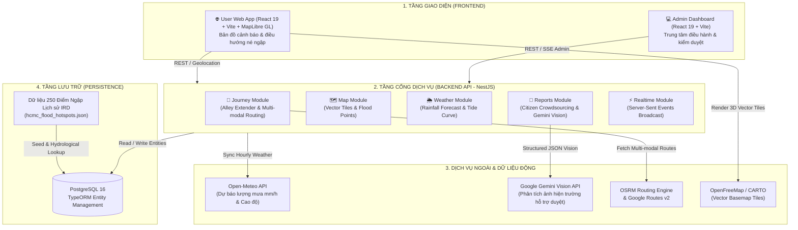
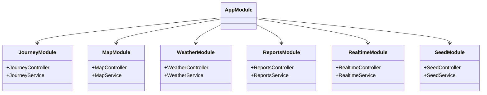
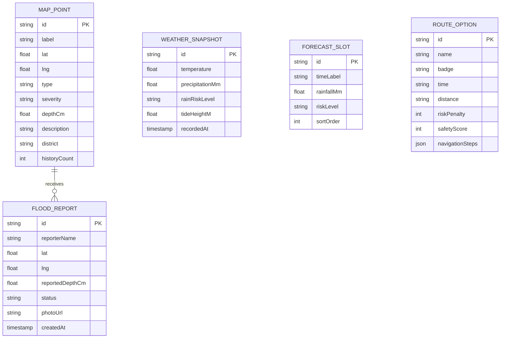

# SYSTEM DESIGN DOCUMENT
## SaigonDrain AI — Kiến Trúc Hệ Thống Dự Báo Ngập & Điều Hướng Thông Minh TP.HCM

**Mã tài liệu:** SD-SYS-2026-V2  
**Phiên bản:** 2.0.0 (Unified Monorepo Architecture)  
**Tác giả:** Đội ngũ Kỹ sư Hệ thống SaigonDrain AI  
**Trạng thái:** Implemented & Verified  

---

## 1. Kiến trúc Tổng thể Hệ thống (System Architecture Overview)

Hệ thống được tổ chức theo mô hình **Unified Monorepo**, phân tách rành mạch thành 4 tầng thành phần:



---

## 2. Thiết kế Chi tiết các Phân hệ (Subsystem Designs)

### 2.1. Phân hệ Frontend (`FE/`)

Cấu trúc thư mục được quy hoạch chuẩn:
```text
FE/
├── user/      # Ứng dụng Web người dùng cuối (React 19 + Vite + MapLibre GL)
└── admin/     # Bảng điều khiển quản trị viên đô thị (React + Vite + Recharts)
```

#### 2.1.1. Ứng dụng Người dùng (`FE/user`)
- **Framework & Công nghệ:** React 19, TypeScript, Vite, Tailwind CSS v4.
- **Bản đồ số & Điều hướng:** MapLibre GL tích hợp nguồn vector tiles miễn phí (OpenFreeMap Liberty / Bright / CARTO Voyager). Hỗ trợ định vị GPS thời gian thực (`navigator.geolocation`), xoay bản đồ theo hướng di chuyển (bearing tracking), và hiển thị vệt đường ngập (polyline có phân màu rủi ro).
- **Trải nghiệm chọn phương tiện thông minh:**
  - Tùy chọn 🛵 **Xe máy** (mặc định) và 🚗 **Xe hơi** với chip chuyển đổi trực quan.
  - Toàn bộ tùy chọn lộ trình ("Tuyến đề xuất", "Tuyến dự phòng") và nút "Bắt đầu điều hướng" chỉ xuất hiện sau khi người dùng chọn xong cả Điểm đi và Điểm đến.

#### 2.1.2. Bảng Điều khiển Quản trị (`frontend/admin`)
- **Framework & Công nghệ:** React 18, TypeScript, Vite, Tailwind CSS, Lucide React, Recharts.
- **Chức năng:**
  - **Overview Page:** Thống kê tổng số điểm ngập đang hoạt động, lượng mưa hiện tại, mức cảnh báo triều cường đỉnh trong ngày, biểu đồ phân bố điểm ngập theo 24 quận/huyện.
  - **Reports Moderation Queue:** Tiếp nhận phản ánh ngập từ người dân, xem ảnh đính kèm, tọa độ, duyệt (Accept) hoặc từ chối (Reject) với cập nhật tức thời qua Server-Sent Events (SSE).
  - **Operations Map:** Bản đồ tác chiến trực quan hóa vùng rủi ro cao dựa trên dự báo thời tiết và dữ liệu ngập lịch sử.

---

### 2.2. Phân hệ Backend (`backend/`)

Xây dựng trên nền tảng **NestJS**, tuân thủ nghiêm ngặt nguyên lý Dependency Injection và cấu trúc module hóa:



#### 2.2.1. Thuật toán Định tuyến & Tránh ngập Đa phương tiện (`JourneyService`)
1. **Thuật toán Alley Extender (Kết nối từ Hẻm):**
   - Người dùng thường bắt đầu chuyến đi từ nhà riêng trong các con hẻm nhỏ không có tên đường chính thức trên bản đồ giao thông động.
   - Khi nhận tọa độ `(fromLng, fromLat)`, hệ thống tính khoảng cách Haversine tới nút giao trục đường gần nhất:
     $$d_{\text{start}} = \text{haversine}((\text{lat}_{\text{user}}, \text{lng}_{\text{user}}), (\text{lat}_{\text{road}}, \text{lng}_{\text{road}}))$$
   - Nếu $d_{\text{start}} > 8\text{ mét}$, thuật toán tự động bổ sung tọa độ điểm xuất phát vào chuỗi hình học (polyline) và sinh bước điều hướng mở đầu:
     `"Từ vị trí trong hẻm, đi thẳng ra [Tên đường] ([d] mét)"`.
2. **Quy tắc Trọng số theo Phương tiện (Vehicle-Specific Weighting):**
   - **🛵 Xe máy:**
     - Cho phép đi qua hẻm kết nối.
     - Phạt rủi ro (Risk Penalty) theo mức độ nghiêm trọng của điểm ngập trong bán kính 300m: `critical` = 50 điểm, `high` = 30 điểm, `medium` = 15 điểm.
     - Ngưỡng cảnh báo độ sâu: $\ge 15\text{ cm}$. Ngưỡng cấm: $\ge 20\text{ cm}$.
   - **🚗 Xe hơi:**
     - Tự động phạt nặng lộ trình đi qua đường hẹp hoặc hẻm cụt.
     - Phạt rủi ro ngập tăng gấp đôi so với xe máy vì nguy cơ hỏng động cơ (thủy kích) và khó quay đầu xe: `critical` = 120 điểm, `high` = 70 điểm.
     - Khi phát hiện tuyến đường chính bị ngập sâu, thuật toán tự động kích hoạt điểm trung gian (detour waypoint) để ép OSRM tìm tuyến đường vòng qua các đại lộ lớn.
     - Ngưỡng cảnh báo độ sâu: $\ge 25\text{ cm}$. Ngưỡng cấm: $\ge 35\text{ cm}$.
3. **Sinh Tuyến đường Đôi (Dual-Route Generation):**
   - Gọi OSRM API với tham số `alternatives=true`.
   - Nếu OSRM chỉ trả về 1 tuyến đường hoặc 2 tuyến có chiều dài/thời gian trùng lặp, hệ thống tự động chèn điểm uốn (midpoint detour vector) lệch $0.0055^\circ$ kinh độ / vĩ độ để tạo ra 2 lựa chọn có số km và thời gian thực tế rõ rệt: **Tuyến đề xuất** (ưu tiên an toàn/khô ráo) và **Tuyến dự phòng** (đường vòng thay thế).

#### 2.2.2. Động lực học Mực nước Động (`WeatherService` & `SeedService`)
- Dữ liệu lịch sử từ 425 điểm ngập IRD chứa thông số độ sâu trung bình (`h.depth`, từ $15\text{ cm}$ đến $60\text{ cm}$).
- Mực nước hiển thị không cố định mà biến thiên theo hàm chu kỳ triều cường thời gian thực:
  $$H_{\text{water}}(t, \text{point}) = h_{\text{depth}} \times \left(0.5 + 0.5 \times \sin\left(\frac{2\pi (t - t_{\text{peak}})}{12}\right)\right) + \Delta H_{\text{rain}}$$
  Trong đó:
  - $h_{\text{depth}}$: Chiều sâu ngập đặc trưng của từng tuyến đường.
  - $t_{\text{peak}}$: Thời điểm đỉnh triều trong ngày (buổi sáng $\approx 06:00$, buổi chiều $\approx 18:00$).
  - $\Delta H_{\text{rain}}$: Hệ số nước dâng do lượng mưa Open-Meteo hiện tại.

---

### 2.3. Phân hệ Phân tích Ảnh Hiện trường & Dữ liệu Ngập Lịch sử (`GeminiVisionService` & `dataset/`)

- **Dữ liệu Không gian & Lịch sử Ngập (`dataset/HCMC_floods` & `hcmc_flood_hotspots.json`):**
  - Tổng hợp các điểm đen ngập úng lịch sử tại TP.HCM kèm tọa độ địa lý, quận/huyện, cao độ địa hình (`elevationM`), ngưỡng mưa gây ngập (`rainThresholdMm`) và tần suất lịch sử (`historyCount`).
- **Trợ lý Phân tích Ảnh Đa phương thức (`GeminiVisionService`):**
  - Sử dụng mô hình **Google Gemini Vision (`gemini-2.5-flash`)** kết hợp `responseSchema` (JSON có cấu trúc) để phân tích ảnh hiện trường do người dân gửi lên.
  - Chỉ ước lượng `estimatedDepthCm` khi trong ảnh có vật chuẩn tham chiếu rõ ràng; trả `null` và gắn trạng thái `evidenceStatus: "insufficient_evidence"` khi ảnh mờ hoặc không đủ căn cứ.
  - Kết quả từ AI chỉ dùng làm đề xuất hỗ trợ kiểm duyệt; báo cáo mới luôn ở trạng thái `pending` cho đến khi Quản trị viên xác minh (`verified`).

---

## 3. Thiết kế Cơ sở Dữ liệu (Database Schema)

Hệ thống hỗ trợ song song PostgreSQL 16 (cho môi trường Production với Docker Compose) và SQLite (cho môi trường kiểm thử Local nhanh chóng):



---

## 4. Kiến trúc Triển khai & Vận hành (Deployment & Operations)

### 4.1. Chạy Cục bộ Độc lập (Local Development)
- Tận dụng các script tiện ích chuẩn bị sẵn:
  - `start-all.bat`: Khởi động toàn bộ giao diện người dùng và quản trị (`pnpm run dev`).
  - `start-backend.bat`: Khởi động máy chủ NestJS tại cổng 3000 (`npm run start:dev`).
  - `start-user.bat`: Khởi động ứng dụng người dùng tại cổng 5173.
  - `start-admin.bat`: Khởi động cổng quản trị tại cổng 5174.
